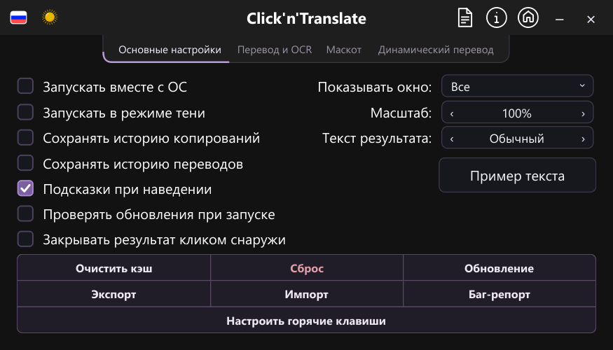
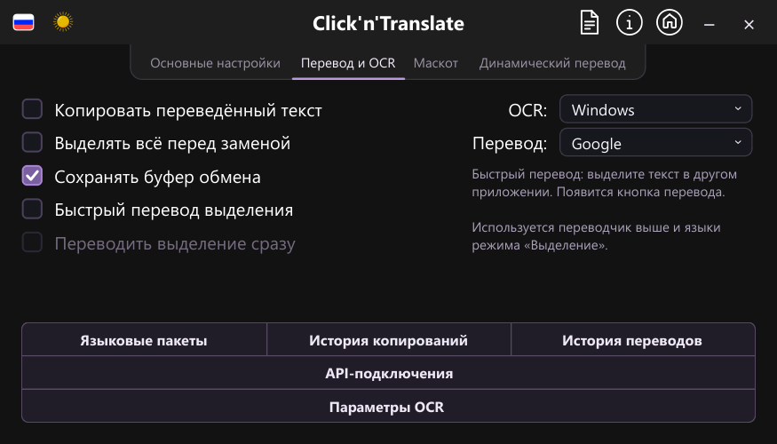
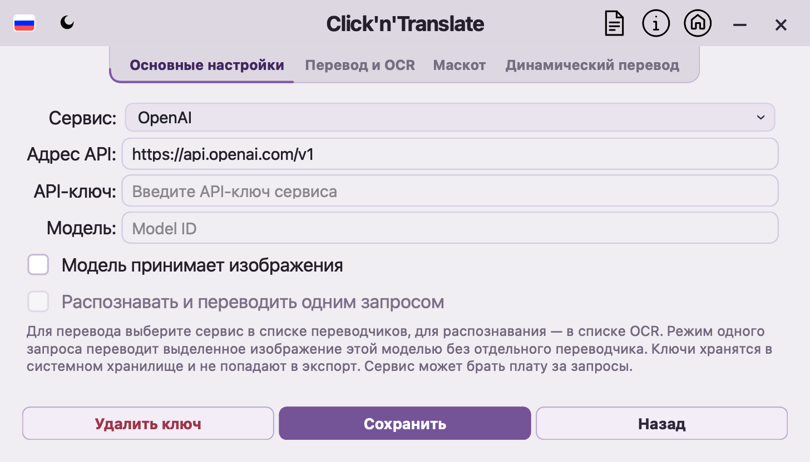

# Проверка настроек, API и сборки macOS

Проверено 22 октября 2026 года. Основная реализация: `c56a55bb1a002358090a1834654e53ade58bcbd0`; дополнение нативной проверки Keychain и упакованного интерфейса: `7671c7e1c356b5736f5bbcd787fb87442e83af73`. Изменения сохранены локально в ветке `codex/pets-mascots`.

## Что изменилось

- В основных настройках собраны общие параметры приложения, показ и закрытие результата, масштаб и размер текста с примером. Настройки переводчика и OCR, действия с выделением и API-подключения находятся в «Перевод и OCR». Нижние кнопки обеих страниц оформлены одинаково.
- Непонятный список «Кнопка у текста» заменён зависимой галочкой «Переводить выделение сразу». Рядом объяснено, что используется выбранный переводчик и языковая пара режима «Выделение».
- Подключены OpenAI, совместимый API, Gemini, Claude и DeepL API; настройка ключа LibreTranslate доступна там же. Модели с поддержкой изображений могут распознать и перевести изображение одним запросом. Ключи хранятся отдельно от JSON-настроек.
- Доступны 63 языка перевода, поиск по названию и коду и ограниченная высота длинных списков. Это языки перевода; число языков интерфейса остаётся равным шести. Каталог согласован с собственной Android-веткой, которая не изменялась.

Использование и ограничения описаны в [инструкции по API](API_CONNECTIONS.md).

## Проверки

| Среда | Полный набор | Дополнительные нативные проверки |
| --- | --- | --- |
| Windows | 2119 passed, 77 skipped; 915 subtests passed | 61 passed, включая размещение меню на двух мониторах |
| macOS 14.3, arm64 | 2052 passed, 144 skipped; 912 subtests passed | 100 passed на Cocoa |

В каждом полном прогоне восемь частей завершились с кодом 0; контроль пользовательских данных подтвердил отсутствие изменений. Дополнительные проверки частично пересекаются с полным набором, поэтому их результаты не следует складывать. Тесты дополнения нативного smoke-контроля: Windows — 80 passed, 3 skipped; macOS — 81 passed, 2 skipped.

Упакованная Mac-сборка запущена через LaunchServices, как при открытии из Finder. Проверены интерфейс и темы, положения окон и меню, экран API, нативная регистрация горячих клавиш, Apple Vision на тестовом изображении, RapidOCR и Argos в упакованных вспомогательных процессах. Проверка Keychain в настоящем GUI-процессе сохранила, прочитала и удалила отдельный тестовый ключ. Windows Credential Manager прошёл аналогичную проверку. Рабочие ключи пользователя не запрашивались.

Собраны DMG и ZIP версии 1.8.2, arm64, с минимумом macOS 13.4. Проверена совместимость 228 Mach-O-файлов. Подпись ad hoc действительна; сборка предназначена для локального тестирования и не нотарифицирована. Контрольные суммы обоих архивов повторно проверены. Подготовка обновления из настоящего ZIP прошла извлечение и проверку подписи, версии и идентификатора приложения. Замена приложения не запускалась; целевой исполняемый файл остался прежним. Транзакция применения обновления и откат проверены автоматическими тестами.

Исходный Mac-репозиторий на ветке `codex/macos-1.7.1`, HEAD `97d3e74b4ef53ba238ba2c6d3418d23dbc1da6ff`, проверен до и после работы: незакоммиченных изменений нет. Перед проверками сохранён архив состояния и патчей. Сборка и все тесты выполнены в отдельном каталоге `~/clickntranslate-qa-20261022`. Приложение в `/Applications` не заменялось.

## Что ещё требует проверки

- Для новой тестовой Mac-сборки пока выключены «Запись экрана» и «Универсальный доступ». Реальный захват экрана и получение выделения из другого приложения не проверены. Проверка OCR на тестовых изображениях и доставка нативного события внутри тестового процесса не заменяют эти сценарии.
- Платные облачные запросы не выполнялись: пользовательские API-ключи не предоставлены. Формат, маршрутизация, ошибки и отмена проверены тестовыми ответами; качество выбранной пользователем модели требует отдельной проверки.
- Нативного устройства Linux не было. Проверены платформенная логика и POSIX-транзакции. Нативные проверки Windows-установщика пропущены, когда отсутствовали необходимые средства сборки.

Ничего не отправлено в GitHub и не опубликовано. Установленные версии, Android-ветка и настройки пользователя сохранены.

Сводка с числами и контрольными суммами: [api-connections-validation.json](api-connections-validation.json).

## Снимки интерфейса

Основные настройки Windows:

Настройки перевода и OCR Windows:

Экран API из настоящей упакованной Mac-сборки:

