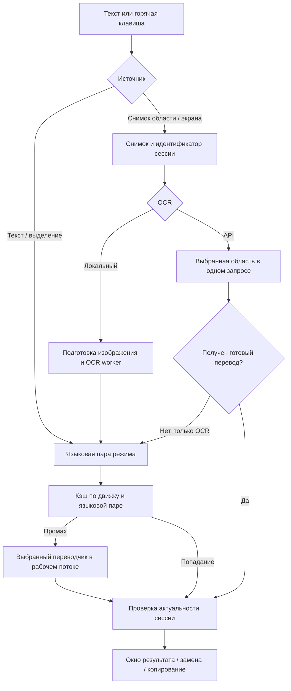

# Техническая проверка десктопной версии — 22 октября 2026

Проверена исходная Python-версия на Windows. Эта работа не обновляет установленное приложение на Mac и не публикует релиз. Замеры ниже характеризуют конкретный стенд Qt, а не гарантированную скорость на любом компьютере.

## Как проходит перевод

1. Главный экран, перевод области, весь экран, выделение, замена и динамический режим сохраняют собственные языковые пары. Ввод на главном экране не должен исчезать после изменения несвязанных настроек.
2. Захват и ответ связаны с сессией. После отмены или нового запроса старый результат не должен менять новое окно. Сетевой вызов, уже принятый сервисом, может завершиться на стороне сервиса: отмена в клиенте не гарантирует отмену списания.
3. Локальные OCR-движки работают через workers. Ветка API получает оригинальное цветное изображение до локальных вариантов обработки. В режиме «Распознавание и перевод» один ответ содержит исходный текст и перевод; второй переводчик для этого снимка не вызывается.
4. Текстовый перевод использует кэш. Файл читается лениво один раз для профиля, затем поиск идёт по словарю в памяти. Размер ограничен 1000 записями, сохранение вынесено в поток; переписывать этот механизм ради ускорения чтения не понадобилось. Идентичность API-подключения учитывает адрес, модель и ключ, чтобы не смешивать результаты разных подключений.
5. Динамический режим сравнивает уменьшенные отпечатки кадров и распознанный текст. Одновременно выполняется один перевод; при изменениях сохраняется последний ожидающий текст вместо неограниченной очереди. Неподвижный кадр периодически перепроверяется после ошибок OCR. Динамический OCR имеет отдельную конфигурацию локального движка; объединённый API-запрос не запускается автоматически для каждого кадра.
6. Окно результата учитывает настройку размера текста отдельно от масштаба интерфейса. Закрытие кликом снаружи находится в «Перевод и OCR», а способ запуска выделения — в редакторе существующего режима «Выделение».

Основные участки: `main.py`, `src/ocr.py`, `src/api_ocr.py`, `src/translater.py`, `src/cache_manager.py`, `src/game_mode.py`.

## Что тормозило интерфейс

Профиль показал затраты на повторный `setStyleSheet`, поиск отсутствующих Python-атрибутов через метаобъект Qt и обработку несвязанных событий общими фильтрами. Смена темы также оформляла скрытые элементы главного экрана. Это не основание переносить приложение с Python на другой язык: измеренная задержка находилась преимущественно в работе с Qt.

Исправлено:

- Скрытые элементы главного экрана получают новую тему при возвращении. Если тему переключили туда и обратно, лишней обработки нет.
- Кэш главного экрана зависит от действительно влияющих на него настроек. Флаги истории и автозапуска больше не заставляют пересоздавать страницу с потерей черновика.
- Поиск темы у дочерних виджетов избегает дорогого поиска отсутствующих атрибутов PyQt.
- Фильтр кнопок сразу пропускает события, не относящиеся к фокусу и указателю.
- Контроллер оформления не обходит все окна повторно, когда масштаб и тема не изменились.

### Замеры

Один и тот же fixture приложения, Qt offscreen, прогретые страницы, завершение очереди событий и `grab()` после действия. Сравнение «до / после» выполнено с включённым cProfile. Для каждого повторяемого действия указана медиана; отдельный запуск без профилировщика приведён отдельно.

| Действие | До, cProfile | После, cProfile | После, без cProfile |
|---|---:|---:|---:|
| Смена темы в настройках, 8 повторений | 245,54 мс | 99,86 мс | 79,50 мс |
| Смена темы на главном экране с сохранёнными настройками, 8 повторений | 177,57 мс | 125,64 мс | 101,02 мс |
| Открытие прогретых настроек, 8 повторений | 7,33 мс | 6,41 мс | 5,06 мс |
| Возврат на прогретый главный экран, 8 повторений | 8,16 мс | 6,54 мс | 5,15 мс |
| Смена темы при открытой странице API, 6 повторений | — | 174,18 мс | 135,53 мс |

Смена темы в настройках требует примерно на 59% меньше времени в сопоставимом профилировании. Нативная отрисовка Windows, другой DPI и нагрузка системы могут дать иные числа. Холодный запуск OCR, скорость облачной модели и загрузка офлайн-моделей не измерялись этим UI-тестом.

## API и ключи

- Подключения OpenAI, совместимого сервера, Gemini, Claude и DeepL имеют отдельные протоколы. Ключи хранятся в системном хранилище, а не в JSON настроек.
- Ключ добавляется в заголовок конкретного запроса. Он не становится постоянным заголовком общей HTTP-сессии. Автоматическое следование перенаправлениям отключено.
- Проверен реальный локальный HTTP-сервер: разные заголовки двух запросов не смешиваются, ключ не появляется в теле, ответ 302 не вызывает следующий запрос.
- Пустой ответ системного хранилища кратковременно кэшируется на 15 секунд, чтобы многократное открытие UI не повторяло обращение. Сохранение ключа сбрасывает этот кэш сразу. Ошибки хранилища не кэшируются как отсутствие ключа.
- Когда один выбранный сервис отвечает за OCR и перевод, общий селектор переводчика становится неактивным. При разных сервисах текстовый переводчик остаётся доступен для текстовых сценариев. Ссылка под селекторами ведёт к настройке фактического API.
- Платные запросы с пользовательскими ключами в этой проверке не выполнялись. Контракты пяти сервисов проверены тестами, транспорт — локальным сервером. Качество и доступность конкретной модели требуют проверки с действующим ключом.

## Экспорт и импорт

Исправлены два практических дефекта: импортированная языковая пара больше не перезаписывается значениями старых комбобоксов; позиция питомца сохраняется как проверенная структура. Экспорт рекурсивно исключает известные поля секретов, включая старые вложенные настройки. Настройки API проходят отдельный список разрешённых полей.

Экспорт пишется во временный файл с уникальным именем рядом с целевым, затем заменяется атомарно. Ошибка замены сохраняет прежний экспорт и не удаляет чужой `.tmp`. Импорт ограничен 1 МиБ, поддерживает UTF-8 BOM, отклоняет неподходящий формат, небезопасные типы и нечисловые значения. Проверены запись настоящего JSON, отказ записи, восстановление языка/флагов/позиции, слишком большой файл и обновление контроллера перевода выделения.

## Диагностика

ZIP формируется в рабочем потоке. Во время записи Qt продолжает принимать события. Источник настроек — фактический каталог текущего профиля, а не предполагаемая папка рядом с исходниками.

Дополнены версии Qt/PyQt и зависимостей, геометрия экранов и DPI, память и число потоков процесса, безопасные признаки настройки API, а также ограниченные замеры `ui.theme`, `ui.home`, `ui.settings`, `api.request`. В памяти хранится не больше 64 последних замеров на операцию и 32 имён операций. Тайминги не содержат параметров вызовов, исходного текста, ответа или адреса API.

В отчёт не добавляются снимки экрана, история, буфер обмена и исходные OCR-логи. Обезличивание охватывает заголовки ключей, Bearer, параметры URL и известные ключи текущей сессии. Архив создаётся локально; отправка выполняется пользователем.

## Языки и дальнейшее расширение

Языки перевода текста и языки интерфейса — разные каталоги. В этой версии доступны 63 языка текста, поиск по названию/коду и ограниченная высота списка с прокруткой. Эти названия малы по объёму и поставляются вместе с приложением; скачивание названия языка с GitHub добавило бы сетевую зависимость без практической пользы. Офлайн-модели устанавливаются отдельно по необходимости.

Португальский и итальянский полностью подключены к существующим таблицам UI, включая подсказки, ошибки, справку и все 32 шага гайда. Расширенный `tools/audit_locale_catalogs.py` учитывает также массивы подписей, подсказок и шаблонов: 253 таблицы, 1197 английских текстовых записей; пропусков, ошибок подстановок и HTML-разметки у новых локалей не найдено. Проверки геометрии расширены для восьми локалей. Подробности — в `docs/LOCALIZATION.md`. Это структурная проверка, а не автоматическая оценка качества языка.

Для перехода на полноценные каталоги нужны стабильные смысловые ID вместо номеров строк, единый загрузчик с кэшированием, проверки форматирования/разметки/множественного числа и просмотр всех экранов. Каталоги следует включать в сборку, выбирать локально и показывать язык в списке только после завершения перевода и проверки фиксированных окон.

## Проверки и границы

Регрессии проверяются `tools/run_ci_tests.py` в отдельных процессах и изолированных профилях, Qt offscreen. Покрыты навигация и сохранение черновика, обе темы, фиксированная геометрия, API-режимы, транспорт, экспорт/импорт и асинхронная диагностика. Итог: **2188 тестов прошли, 77 пропущены** по ограничениям платформы и отсутствующим инструментам сборки. Первоначально обнаруженные проблемы исправлены; целиком повторены затронутые блоки и финальные технические проверки. Во всех прогонах исходные пользовательские данные остались неизменными.

Нативная исходная Windows-версия была запущена, фактическое окно настроек проверено по снимку самого приложения. После просьбы пользователя работать в фоне тестовое окно закрыто; автоматические проверки больше не открывают окна на рабочем столе. Mac и Linux требуют последующей проверки на своих системах после согласования Windows-интерфейса.
