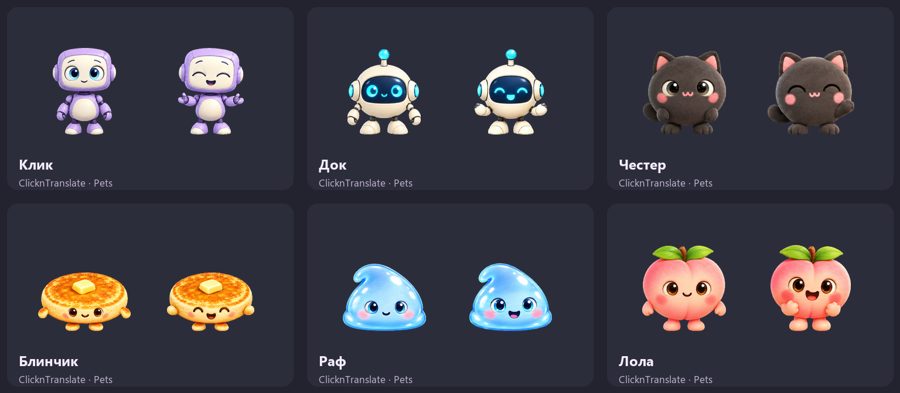
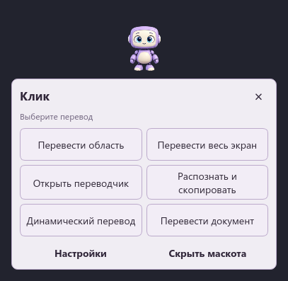
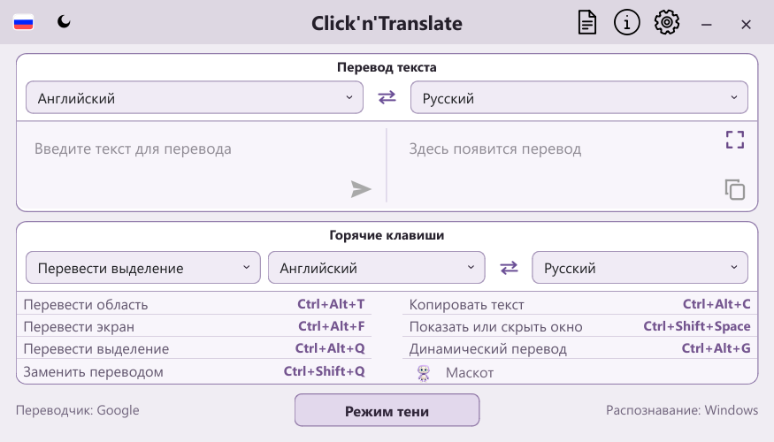
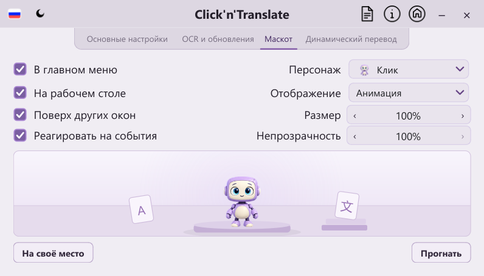
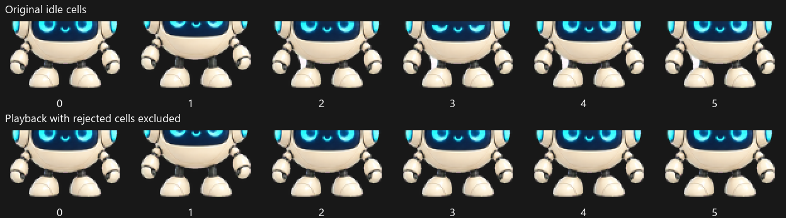
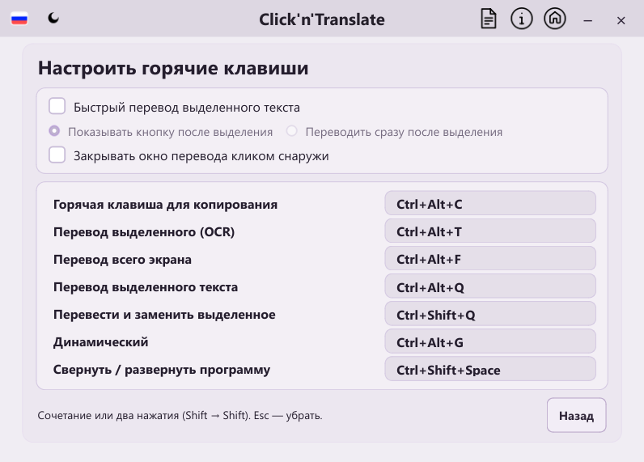

# Pets v18 mascot integration

The six companions use complete image-generated poses in the Pets v2 format.
Doc, Chester, Blinchik, Raf and Lola were regenerated from their identity cues;
Click uses the previously accepted original robot atlas. Extra sleep and emotion
strips are retained as generation provenance; the app does not load them. Generation used OpenAI's built-in imagegen through Pets
create-pet v0.1.6. Actual generation prompts are preserved in `PROMPTS.md`.

All six atlases are transparent 1536×2288 PNGs with 192×208 cells. The nine
animation rows contain 6, 8, 8, 4, 5, 8, 6, 6 and 6 frames; the last two rows
contain sixteen clockwise gaze directions. Playback uses only the seven stationary
native states and gaze; the two gait rows are never selected. One shared registration transform per source row
preserves the generated motion, and a common cell viewport keeps the body
anchored. A final chroma-edge pass is applied once to each encoded artifact.

| Companion | Stable settings key | Measured jump lift | Atlas SHA-256 |
| --- | --- | --- | --- |
| Click | `click` | 47 px | `4003554f70c1956e32e6365dc0952f0c984be0d3865a44704cb7ea57a03e28e7` |
| Doc | `orbit` | 26 px | `dc53e5aa3fdd2f816d5a23364d6acffb5bec8aedc0def2971230a6649aa8b6c6` |
| Chester | `mochi` | 50 px | `892d085420eadab8910947a507df6a01b8f04c005c49366638facab10099ac08` |
| Blinchik | `pancake` | 63 px | `52ed7ad5667e3487f150c44f1c9b5bb09450af62c5adffde41787265c9e579e7` |
| Raf | `bubu` | 76 px | `99129426d8fe6069dbb2356e6e5ccc6a07218f1102fdf65d275e2b8323c74a6e` |
| Lola | `momo` | 34 px | `6db968c1e8977364f3afed4d2ffa1e628f5b30d516cc2f3384998ef18e1ea57a` |

`validation.json` records the exact encoded hashes, structural gates, visible
jump displacement, quality gates and the result of three independent blind
direction reviews. All cardinals passed without ambiguity. Small differences
between neighboring diagonal angles and local pixel-difference outliers were
visually reviewed and retained as warnings. The Pets MCP preflight accepted
every final atlas. Full decoded source strips, canonical references, rejected
revisions, assembly scripts and detailed QA are preserved in the separate local
source archive.

Both companion views stay at a fixed position and render complete v2 frames.
There is no automatic walking, crawling, synthetic limb motion, sleep or extra
emotion strip in the app. `running` means active work in the Pets contract;
it uses row 7, never either directional gait row. The native state mapping is:

| Native animation | ClicknTranslate scenario |
| --- | --- |
| idle | Quiet, stationary breathing between interactions |
| waving | Greeting on click; opens actions beneath the pet |
| jumping | Translation completed successfully |
| running | Text/document/OCR/live translation is processing |
| waiting | Waiting for input or choosing an action in the open menu |
| review | Checking the finished result after the success jump |
| failed | Translation failed; the user can retry |
| sixteen look directions | Follow the local pointer while calm |

The desktop popup offers screen, region, text, OCR copy, live and document
translation, companion settings and hide. It has no manual emotion controls.
Opening it triggers a greeting and then waiting; translation events choose the
other states automatically. Returning home triggers a jump; opening tools or
changing size/opacity acknowledges the action with review. Real work always
takes priority. Click reactions also play once from a static built-in pose,
then restore that pose. Custom images remain static. Hovering and the open menu
keep playback running. Manual dragging still places the pet; capture hides the
companion before screenshots.

The main window shows one static shortcut for the selected companion. Clicking
the character or name opens Mascot settings directly, focused on its carousel.
The shortcut uses a cached 48×52 PNG extracted from the native idle frame; it
does not decode a sprite atlas or run an animation timer. All six companions
remain available in settings and on the desktop.

Navigation retains the home widgets and translation draft while settings are
open, invalidating the cache when the configuration, language, theme or minimum
content size changes. Atomic page changes prevent an empty intermediate paint.
In the same local Qt fixture, repeat returns fell from 99–100 ms to 5–6 ms;
the initial return fell from 368 ms to 9 ms. These are local measurements with
profiling enabled, not a device-independent latency guarantee.

Settings match the other tabs: one column of checkboxes on the left, aligned
labels and 180 px controls on the right, with the same 28 px control height.
The right column contains display mode, size and opacity. Display
modes are animated, still and custom image; there is no static emotion picker.
A themed desk scene below the form gives the selected character a podium,
soft background and a platform carousel. Previous/next arrows select the six
characters with a short sliding transition; each name appears above its head.
Rapid clicks continue from the current visual frame. There is no duplicate
character dropdown. Clicking the scene triggers one native jump. It also
reflects real translation status, and its timer stops while
hidden or minimized. All decoration is drawn by Qt using the app palette.

Main text translation, document translation, area OCR, fullscreen OCR and both
live translation modes report activity on the GUI thread. Concurrent jobs hold
the working state; cancellation clears only its own job, and stale results are
ignored by existing session guards. Click greetings and scene interactions still
work with automatic translation reactions disabled, without masking an active job.

Existing character IDs, positions, custom images and capture ownership remain
compatible. Old walking profiles migrate to stationary animation. Old custom
emotion/sleep choices map to their nearest native pose. Walking speed and pause
controls have been removed. Settings offer a character carousel, display mode, size, opacity,
visibility and automatic event reactions. Click and stationary animation are the
defaults for new configurations.

Picker thumbnails retain one 192×208 cell. The desktop and settings scene share
the full atlas only when animation needs it. The desktop layered surface clears
its alpha channel before every pose so earlier frames cannot leave fragments
around Doc or the other characters. All native frames and sixteen gaze angles
are checked against fresh transparent renders. The Windows, Linux and macOS
packaging specifications include the icons folder.
No plugin connection is required for playback.

Doc's idle cells 2–5 contain a malformed white left ankle in the original
artwork. Playback substitutes the clean resting cell 0 for these slots, keeping
the native raised cell 1 and the original 1.1-second cadence. The same mapping
applies to full-size, compact and legacy idle poses. Other reactions, gaze
directions and character atlases retain their original frames.

Blank clicks finish numeric edits and clear text selection and keyboard focus,
including inside the scaled graphics canvas. Arrow hover is tracked separately
from Qt's native proxy hover state; Tab navigation retains its focus indicator.
Language package tables have rectangular frames, themed full-row selection and
columns fitted to the available width, with tooltips for elided package/status
values.

Popup anchors map through the visible scaled canvas into native screen
coordinates. The flag menu, language lists and context menus follow the moved
window, including monitors with negative coordinates, and stay within the
available screen bounds. Button labels, tooltips and accessibility names have
been audited in English, Russian, Spanish, German, French and Chinese: close,
home/back, cancel, undo and pause/resume actions use their actual meanings.
Shared standard dialog buttons follow the app language rather than the OS.

General settings include the optional **Select all before replacing** checkbox.
The right column groups the OCR, translator, result visibility and result-font
dropdowns, followed by interface scale at the bottom. Result font size affects
only source/translation text in the separate result window; its tooltip explains
the distinction from interface scale in all six languages.
The translate-and-replace action first selects the entire active input, then
uses the existing translation and verified-selection replacement pipeline. The
option is off by default, does not affect ordinary selection translation or
dynamic translation, and does not send chat messages. Windows uses Ctrl+A;
macOS uses Cmd+A. Replacement remains unavailable on Linux. If the target loses
focus before selection, the operation stops before changing the clipboard.

PR #7 is merged and integrated: optional quick selection translation, result
font size and closing the result on an outside click. Quick selection reads run
in a bounded background worker, preserve clipboard text on the Ctrl+C fallback,
and reject stale selections or changed foreground targets. Repeated probes
coalesce, and a floating-button click rechecks the selected text before emitting
a translation request. The new hotkey-page toggles use the same accent style.

Review with `python tools/preview_mascots.py` or open the actual application using
`python tools/run_mascot_app.py`, which uses its own profile with translation,
global hotkeys and the optional quick-selection feature active. This review copy
does not create a tray icon or alter OS autostart. Production-rendered
stationary animation and 42 native static choices can be exported with
`python tools/qa_mascot_motion.py OUTPUT_DIRECTORY`.
