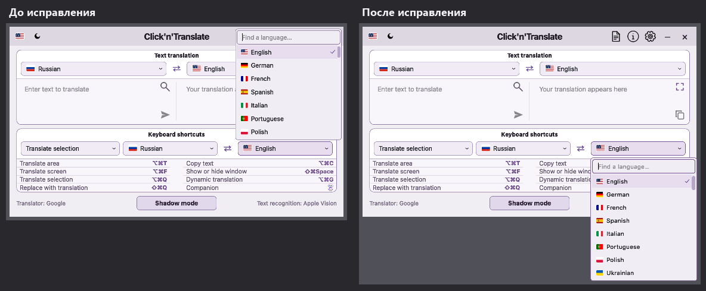
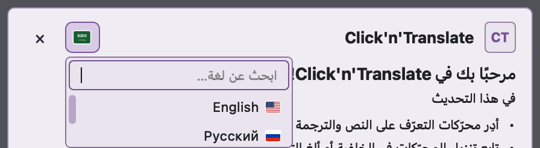
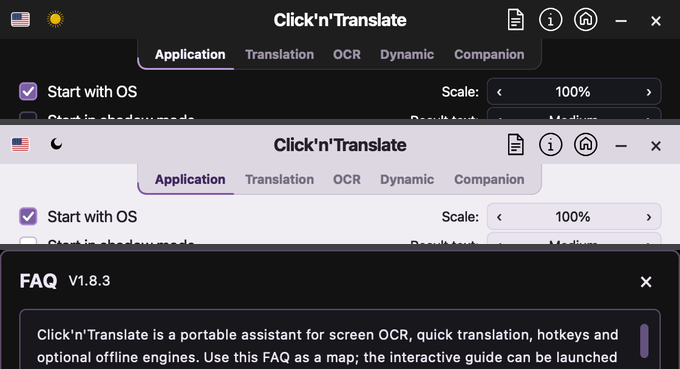

# Проверка ClicknTranslate 1.8.3 · 28 ноября 2026 года

## Выпадающие списки на Mac

В блоке «Горячие клавиши» все три списка открывались вверх даже при свободном месте под окном. На MacBook Air повторили открытие мышью при тех же координатах до и после исправления. На новом варианте список открывается под полем с зазором 3 логических пикселя. У нижнего края экрана доступное место определяет высоту списка. [Изменение](https://github.com/jabrailkhalil/clickntranslate/commit/f7c6fd61dd660556c286b321a962f7a3a2d2c176) · [Протокол](checks.json)

Измерили первый кадр 40 открытий в главном окне и настройках при масштабе 80, 100, 135 и 150%. Проверили английский, русский и арабский интерфейсы. Во всех случаях последняя строка была полностью видна после прокрутки. Отдельно проверили выбор мышью и клавиатурой, переход в соседний список одним кликом, закрытие по Escape и клику снаружи. После переключения на тёмную тему исправили цвет заголовков «Перевод текста» и «Горячие клавиши». [Исправление заголовков разделов](https://github.com/jabrailkhalil/clickntranslate/commit/613c67d7342e9bab759ddb7482358957b6fdb533)

В списке «Показывать результат» оставили место для полосы прокрутки, когда экран ограничивает высоту. На MacBook проверили все пять строк при масштабе 150% и свободном пространстве в 95 логических пикселей. И русские, и арабские подписи при прокрутке помещались целиком по ширине. [Изменение](https://github.com/jabrailkhalil/clickntranslate/commit/06261adfde186e305dcb9aa3af658cfbb84191dd)

В приветственном окне меню под флагом языка тоже открывалось вверх. Оно использовало отдельное правило размещения. Теперь это общий список с поиском. На Mac проверили английский и арабский интерфейсы в центре, у нижнего края и с 79 логическими пикселями под полем. Во всех шести случаях список открылся под флагом, последняя строка была доступна прокруткой. В арабском интерфейсе край списка совпал с левым краем флага, в английском — с правым. [Исправление](https://github.com/jabrailkhalil/clickntranslate/commit/15deff5e3fc7813c62acf3aabb1a6a74bd8c145d)

## Заголовки окон и FAQ

На MacBook Air с macOS Sonoma 14.3 проверили русский, английский и арабский интерфейс. Главное окно и настройки показывают `Click'n'Translate`, номер `V1.8.3` виден только в FAQ. Проверка охватила и приветственное окно. На Windows прошли 213 из 213 целевых тестов первого запуска и диалогов. [Протокол](checks.json) · [Изменение заголовков](https://github.com/jabrailkhalil/clickntranslate/commit/0ced7ce6bd957857e133de0830ce601a50e846e8)

## Приложение на MacBook Air

Кандидат `15deff5` из DMG запустился через LaunchServices. В установленном приложении проверили 192 открытия в 96 сочетаниях поля, масштаба и темы. Списки в главном окне, настройках, приветственном окне и окнах перевода текста и документов открылись с зазором 3 логических пикселя под полем. Также проверили размещение диалогов в 48 случаях, настройки, FAQ и Apple Vision. SHA‑256 образа совпал с манифестом. Проверка целостности подписи прошла. Gatekeeper отклонил тестовую сборку с локальным сертификатом без нотарификации Apple. [Сборка DMG](https://github.com/jabrailkhalil/clickntranslate/actions/runs/46145090462/job/140979261722) · [Протокол и SHA‑256](checks.json)

Приложению разрешены запись экрана и управление компьютером. У запущенного через SSH процесса Python доступ к управлению выключен. Проверка перевода выделения из другого приложения на физическом Mac остаётся открытой. [Протокол](checks.json)

## Android 15

На эмуляторе Android 15 проверили четыре шага первого запуска, настройки, перезапуск и кнопку «?». Номер 1.8.3 виден в справке. Для целого APK Android открыл системное подтверждение обновления, повреждённый файл приложение отклонило. В отдельном тесте обновление со сборки 45 до 46 сохранило настройку прозрачности и задание в очереди. Использовался временный сертификат CI. Прошли все 2 014 JVM-тестов. На Android 16 с размером страницы 16 КиБ прошли проверки ONNX и Paddle. [Эмуляторы](https://github.com/jabrailkhalil/clickntranslate/actions/runs/46140073563/job/140963850879) · [JVM](https://github.com/jabrailkhalil/clickntranslate/actions/runs/46140073563/job/140963850618)

## Арабский OCR на Linux

На 36 независимых изображениях RapidOCR улучшил точное совпадение букв и огласовок с 7 до 23. Все 7 прежних совпадений сохранились. Медиана времени распознавания после загрузки модели снизилась с 1043,1 до 266,2 мс. В выборке были светлый и тёмный фон. Сравнение пропускало пробелы и пунктуацию. [Прогон Linux](https://github.com/jabrailkhalil/clickntranslate/actions/runs/46137566069/job/140956187304) · [Методика](https://github.com/jabrailkhalil/clickntranslate/blob/deca3593f98ec5ee893aeecc91c173374e4f91e7/tools/qa_arabic_recognition.py#L101)

## Полная проверка Windows и Linux

На `15deff5` прошли 9 026 тестов Windows и 8 938 тестов Linux. Пропущены 101 и 189 соответственно. Все двенадцать заданий завершились успешно. В обеих системах отдельно сверили результаты выбора языка в приветственном окне для двух тем и двух направлений письма. [Полная проверка](https://github.com/jabrailkhalil/clickntranslate/actions/runs/46145092732)

Нативный интерфейс проверили отдельно на Windows x64, Linux X11, macOS Intel и Apple Silicon. На каждой платформе прошли все 485 тестов. В них входят поиск и выбор языка, навигация клавиатурой и центр движков. Обе Mac-сборки также прошли проверку запуска установленного приложения. [Интерфейс на четырёх платформах](https://github.com/jabrailkhalil/clickntranslate/actions/runs/46145094831) · [Сборки macOS](https://github.com/jabrailkhalil/clickntranslate/actions/runs/46145090462)
