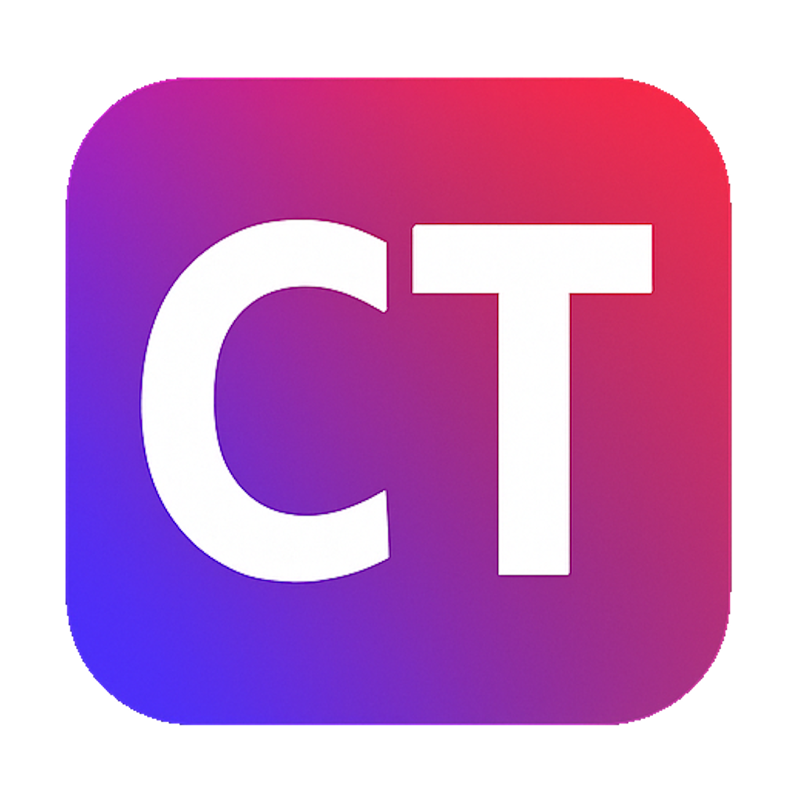
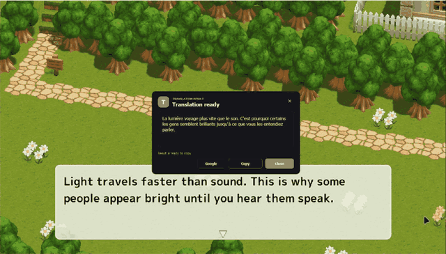
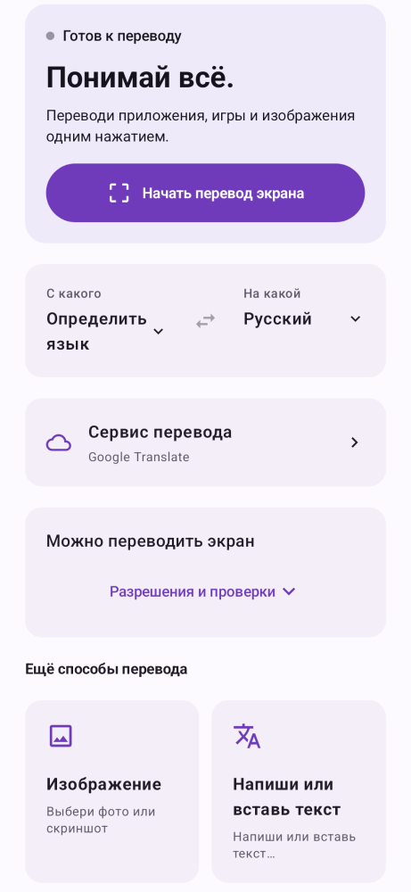
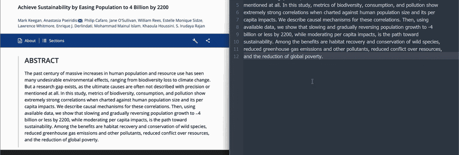
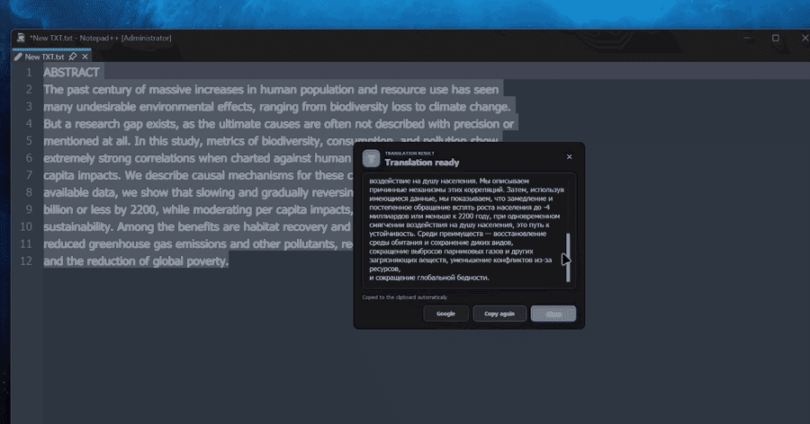
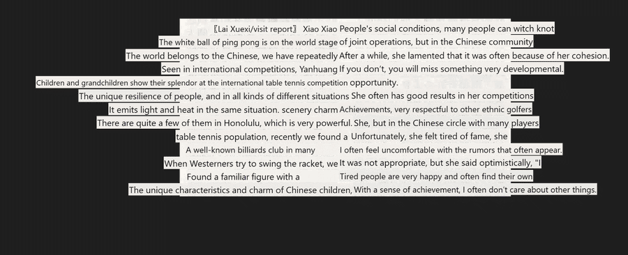

  

<h1 align="center">Click’n’Translate</h1>

  <a href="../../README.md">English</a> ·
  <a href="README.ru.md">Русский</a> ·
  <strong>Español</strong> ·
  <a href="README.de.md">Deutsch</a> ·
  <a href="README.fr.md">Français</a> ·
  <a href="README.zh-CN.md">简体中文</a> ·
  <a href="README.pt.md">Português</a> ·
  <a href="README.it.md">Italiano</a>

<strong>Lee el texto de tu pantalla en tu idioma.</strong>

Windows · macOS · Linux · <a href="#android">Android</a>

  
  &nbsp;&nbsp;
  

  <strong><a href="#download">Descargar</a></strong>
  &nbsp;&nbsp;&nbsp;
  <a href="https://translate.clickn.dev/en/">Sitio web</a>
  &nbsp;&nbsp;&nbsp;
  <a href="https://t.me/jabrail_digital">Telegram</a>

Traduce juegos, copia texto de imágenes, entiende documentos y sustituye mensajes por su traducción. Aplicación gratuita y de código abierto para **Windows, macOS y Linux**, con una edición independiente para **Android**.

  

## Descargar 1.8.2

| Sistema | Instalar | Portátil |
| --- | --- | --- |
| **Windows** 10/11 · x64 | [EXE](https://github.com/jabrailkhalil/clickntranslate/releases/download/v1.8.2/Click-n-Translate-1.8.2-windows-x64-installer.exe) | [ZIP](https://github.com/jabrailkhalil/clickntranslate/releases/download/v1.8.2/Click-n-Translate-1.8.2-windows-portable-x64.zip) |
| **macOS** 13.4+ · Apple Silicon (M1+) | [DMG](https://github.com/jabrailkhalil/clickntranslate/releases/download/v1.8.2/Click-n-Translate-1.8.2-macos-arm64.dmg) | — |
| **macOS** 13.4+ · Intel | [DMG](https://github.com/jabrailkhalil/clickntranslate/releases/download/v1.8.2/Click-n-Translate-1.8.2-macos-x86_64.dmg) | — |
| **Linux** · x86_64 | [AppImage](https://github.com/jabrailkhalil/clickntranslate/releases/download/v1.8.2/Click-n-Translate-1.8.2-linux-x86_64.AppImage) | [tar.gz](https://github.com/jabrailkhalil/clickntranslate/releases/download/v1.8.2/Click-n-Translate-1.8.2-linux-x86_64.tar.gz) |
| **Android** 8.0+ · ARM64 | [APK](https://github.com/jabrailkhalil/clickntranslate/releases/download/v1.8.2/ClicknTranslate-1.8.2-arm64.apk) | — |

[Todas las descargas](https://github.com/jabrailkhalil/clickntranslate/releases/tag/v1.8.2)

## En Android: traduce sin salir de tu aplicación

**Un botón flotante para juegos y aplicaciones, además de traducción de texto y fotos.** Funciona en el teléfono; no necesita ordenador ni acceso root.

  <picture>
    <source media="(prefers-color-scheme: dark)" srcset="../images/android-home-dark-1.8.2.png">
    
  </picture>

Interfaz de Android 1.8.2, mostrada en ruso. Disponible en seis idiomas, incluido español.

1. **Instala el APK** en un dispositivo Android 8.0+ ARM64. Elige el idioma de la interfaz, el tema y los idiomas de traducción.
2. **Inicia la traducción de pantalla.** Permite mostrar sobre otras aplicaciones y acepta la captura de pantalla. En Android 14+, comparte toda la pantalla para traducir entre aplicaciones.
3. **Abre tu juego o aplicación y toca el botón flotante.** Lee la traducción sobre la pantalla. Mantén pulsado el botón para elegir una región u otro modo en su menú.

También puedes escribir o pegar texto, compartirlo con **Clickn** desde otra aplicación y traducir fotos o capturas de la galería. Copia o comparte los resultados y consulta el historial local de texto. Google funciona sin clave; ML Kit permite traducir sin conexión tras descargar los modelos de los idiomas compatibles. Los servicios API adicionales utilizan tus propias credenciales.

**[Descargar APK](https://github.com/jabrailkhalil/clickntranslate/releases/download/v1.8.2/ClicknTranslate-1.8.2-arm64.apk)** · [Guía de Android (inglés)](../ANDROID.md) · [Código de Android](https://github.com/jabrailkhalil/clickntranslate/tree/android)

## En el ordenador: del texto al resultado

Traduce una zona, toda la pantalla o una selección de otra aplicación. El modo de sustitución puede seleccionar todo el campo antes de pegar la traducción. La traducción dinámica sigue varias zonas; el espacio de documentos permite editar original y resultado.

## Elige tus motores

Google, MyMemory, Lingva y LibreTranslate para traducción en línea; Argos Translate y Hy-MT para trabajar sin conexión tras descargar modelos. OCR local: Windows OCR, Apple Vision, Tesseract, RapidOCR y EasyOCR, según el sistema.

Configura OpenAI, Gemini, Claude, DeepL, LibreTranslate o una Custom API con tu propia clave en **Settings → Translation and OCR → Language packages → API**. Los modelos compatibles con imágenes pueden reconocer y traducir mediante un proveedor cuando habilitas la entrada de imágenes.

El OCR local mantiene las imágenes en el dispositivo. Los servicios en línea reciben el texto; una API de visión habilitada también recibe la imagen elegida. Cada proveedor tiene sus tarifas y límites. [Privacidad](../../PRIVACY.md).

## A tu manera

Doce idiomas de interfaz, incluido el árabe con diseño de derecha a izquierda, temas claro y oscuro, escala de interfaz, tamaño independiente del texto del resultado, atajos configurables, importación/exportación e historiales locales opcionales. El compañero abre acciones con un clic y puede ocultarse.

Python viene incluido. Windows y Mac usan el certificado autofirmado jabrailkhalil; puede aparecer SmartScreen y la app de Mac no está notarizada. [Primer inicio](../guides/setup.es.md). En Mac, concede los permisos de grabación de pantalla y accesibilidad para las funciones correspondientes. [Linux y atajos](../LINUX.md).

La versión de escritorio 1.8.2 descarga actualizaciones de GitHub Releases dentro de la app. Mac y Linux 1.8.1 o anteriores necesitan instalar esta primera actualización manualmente; las ubicaciones protegidas pueden requerir sustitución manual. Las versiones de Microsoft Store se actualizan desde Store.

Android tiene sus propias vistas de pantalla, texto, fotos e historial: [guía](https://github.com/jabrailkhalil/clickntranslate/tree/android#readme). El contador registra descargas de archivos, no personas únicas.

[Guía completa en inglés](../../README.md) · [Ayuda y errores](https://github.com/jabrailkhalil/clickntranslate/issues) · [GPL-3.0](../../LICENSE)

## Más ejemplos

### Copiar texto de una imagen

### Traducir el texto seleccionado

### Traducir toda la pantalla

Grabaciones de la edición de escritorio; el diseño actual puede ser diferente.
