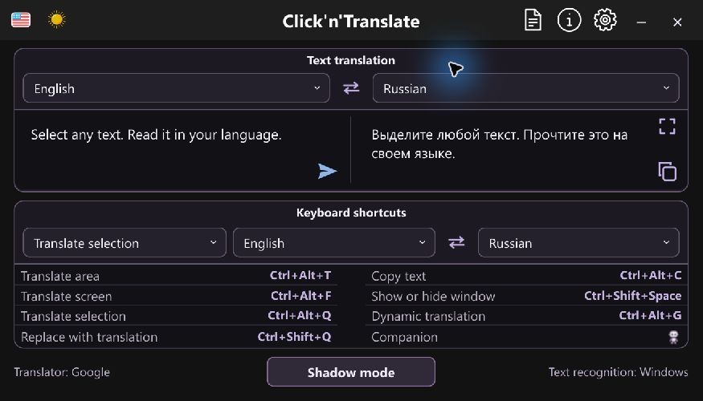
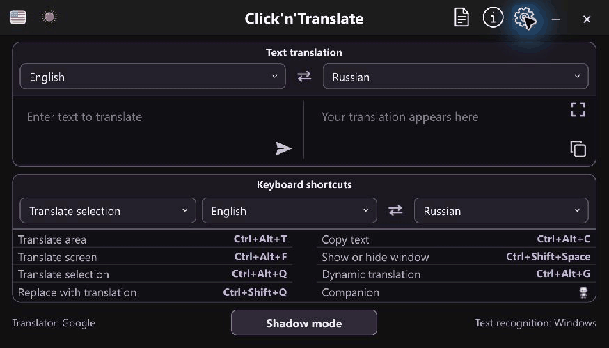
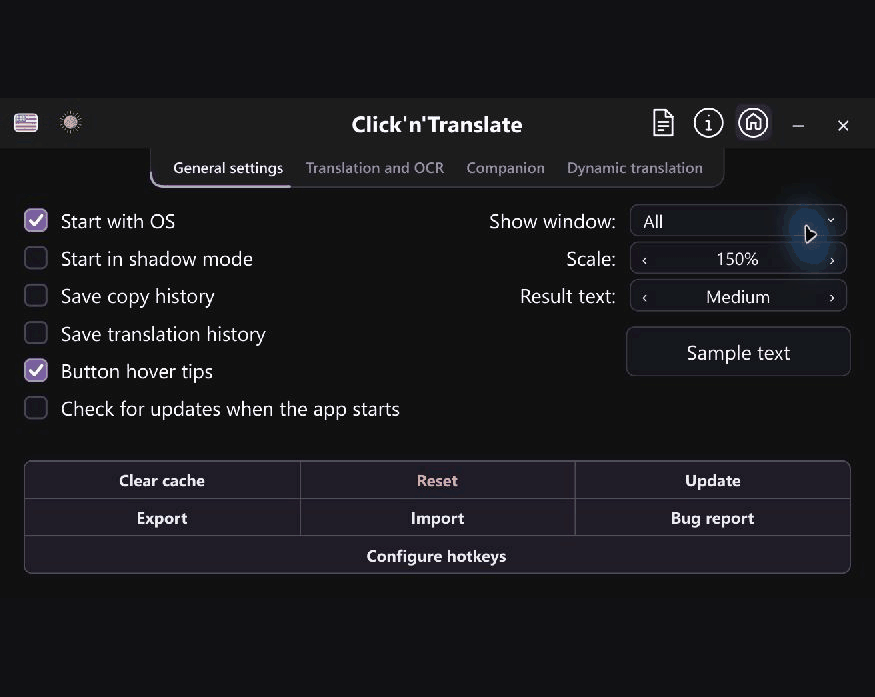
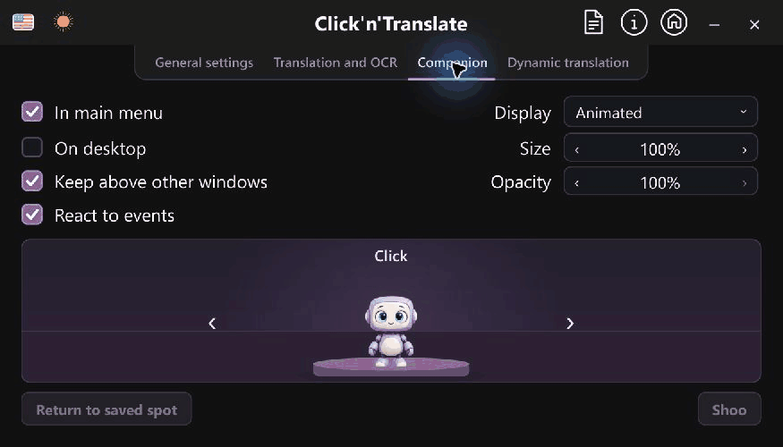

# Click’n’Translate

**Leia o texto da tela no seu idioma.**

Traduza jogos, copie texto de imagens, leia documentos e substitua mensagens pela tradução. Aplicativo gratuito e de código aberto para **Windows, macOS e Linux**, com uma edição própria para **Android**.

[English](../../README.md) · [Русский](README.ru.md) · [Español](README.es.md) · [Deutsch](README.de.md) · [Français](README.fr.md) · [简体中文](README.zh-CN.md) · [Português](README.pt.md) · [Italiano](README.it.md)

## Baixar 1.8.2

| OS | Download |
| --- | --- |
| Windows 10/11 x64 | [Installer](https://github.com/jabrailkhalil/clickntranslate/releases/download/v1.8.2/Click-n-Translate-1.8.2-windows-x64-installer.exe) · [Portable ZIP](https://github.com/jabrailkhalil/clickntranslate/releases/download/v1.8.2/Click-n-Translate-1.8.2-windows-portable-x64.zip) |
| macOS 13.4+, Apple Silicon | [DMG](https://github.com/jabrailkhalil/clickntranslate/releases/download/v1.8.2/Click-n-Translate-1.8.2-macos-arm64.dmg) |
| macOS 13.4+, Intel | [DMG](https://github.com/jabrailkhalil/clickntranslate/releases/download/v1.8.2/Click-n-Translate-1.8.2-macos-x86_64.dmg) |
| Linux x86_64 | [AppImage](https://github.com/jabrailkhalil/clickntranslate/releases/download/v1.8.2/Click-n-Translate-1.8.2-linux-x86_64.AppImage) · [tar.gz](https://github.com/jabrailkhalil/clickntranslate/releases/download/v1.8.2/Click-n-Translate-1.8.2-linux-x86_64.tar.gz) |
| Android 8.0+, ARM64 | [APK](https://github.com/jabrailkhalil/clickntranslate/releases/download/v1.8.2/ClicknTranslate-1.8.2-arm64.apk) |

[Checksums / signatures](https://github.com/jabrailkhalil/clickntranslate/releases/tag/v1.8.2) · [Signing identities](../SIGNING_IDENTITIES.md)

## Do texto à tradução

Reconheça uma região, traduza a tela inteira ou o texto selecionado em outro aplicativo. A substituição pode selecionar todo o campo antes de inserir a tradução. O modo dinâmico acompanha várias regiões. Documentos abrem original e tradução lado a lado.

Online: Google, MyMemory, Lingva e LibreTranslate. Offline: Argos Translate e Hy-MT após baixar os modelos. OCR local: Windows OCR, Apple Vision, Tesseract, RapidOCR e EasyOCR, conforme o sistema.

Configure suas chaves OpenAI, Gemini, Claude, DeepL, LibreTranslate ou Custom API em **Settings → Translation and OCR → Language packages → API**. Ao habilitar imagens explicitamente, modelos de visão compatíveis podem reconhecer e traduzir com um único provedor.

O OCR local mantém as imagens no dispositivo. Serviços online recebem o texto; uma API de visão habilitada recebe também a imagem selecionada. Aplicam-se preços e limites do serviço. [Privacidade](../../PRIVACY.md).

Oito idiomas de interface, incluindo português e italiano, com dicas e guia; temas claro e escuro; escala e tamanho do texto do resultado separados; atalhos personalizados; importação/exportação e históricos locais opcionais.

Python está incluído. Windows e Mac usam o certificado autoassinado jabrailkhalil: o SmartScreen pode avisar e o app Mac não é notarizado pela Apple. [Primeiro uso](../guides/setup.en.md). No Mac, conceda gravação de tela e acessibilidade às funções correspondentes. [Linux e atalhos](../LINUX.md).

A versão desktop 1.8.2 baixa atualizações do GitHub Releases dentro do aplicativo. Mac/Linux 1.8.1 e anteriores precisam instalar esta primeira atualização manualmente; locais protegidos podem exigir substituição manual. Versões Store usam a Microsoft Store. Android tem suas próprias [telas e instruções](https://github.com/jabrailkhalil/clickntranslate/tree/android#readme). O contador mede downloads de arquivos, não pessoas únicas.

[Guia completo em inglês](../../README.md) · [Relatar problema](https://github.com/jabrailkhalil/clickntranslate/issues) · [Telegram](https://t.me/jabrail_digital) · [GPL-3.0](../../LICENSE)
